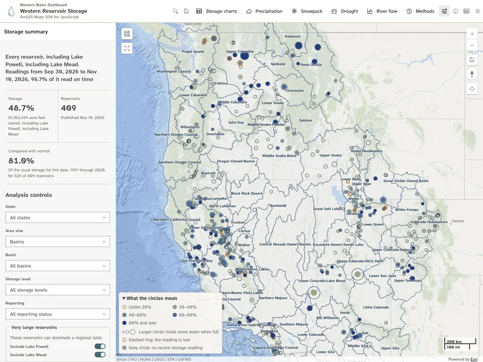
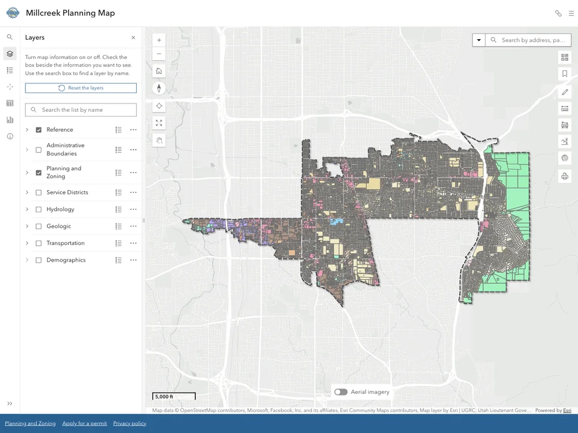
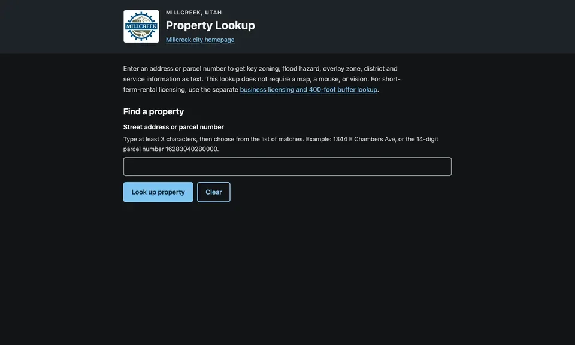

### Brian Busch, GISP

Geospatial web development and cartography, from Salt Lake City, Utah.

I make web maps, data pipelines, and public maps. My day job is GIS at the
City of Millcreek. Here you will find the side projects and the small tools
I share.

**This month:** the [30 Day Map Challenge](https://30daymapchallenge.com/).
Each map, its data, and how I made it are on the
[portfolio](https://buschbrian.github.io/projects/#map-challenge-2026).

 

## Featured

<table>
  <tr>
    <td width="58%" valign="top">
      
    </td>
    <td width="42%" valign="top">
      <h3>Western Water Dashboard</h3>
      
Reservoir storage, mountain snowpack, and drought for eleven western states on one map.

      
A Python pipeline rebuilds its data every morning. The front end runs on the ArcGIS Maps SDK 5.1 and Calcite.

      

        <a href="https://buschbrian.github.io/western-water-dashboard/"><b>Open the dashboard</b></a> 
        <a href="https://github.com/buschbrian/western-water-dashboard">Source</a> ·
        <a href="https://buschbrian.github.io/projects/western-water-dashboard-atlas/">System atlas</a>
      

      
<code>TypeScript</code> <code>Python</code> <code>ArcGIS Maps SDK</code>

    </td>
  </tr>
</table>

## Public apps with the City of Millcreek

<table>
  <tr>
    <td width="50%" valign="top">
      
      <h3>Planning Map</h3>
      
The city's zoning and planning map, with Nearmap aerial imagery, shareable links, and a text alternative.

      
<a href="https://planning.gis.millcreekut.gov/">Live</a> · <a href="https://buschbrian.github.io/notes/millcreek-planning-map/">How it was built</a>

    </td>
    <td width="50%" valign="top">
      
      <h3>Property Lookup</h3>
      
Zoning, flood hazard, district, and utility facts for any address, as plain text. No map, mouse, or vision needed.

      
<a href="https://lookup.gis.millcreekut.gov/">Live</a> · <a href="https://github.com/buschbrian/parcel-lookup-nomap">Source</a> · <a href="https://buschbrian.github.io/notes/millcreek-property-lookup/">How it was built</a>

    </td>
  </tr>
</table>

## Tools

<table>
  <tr>
    <td width="33%" valign="top">
      <a href="https://github.com/buschbrian/dark-sky-shot-planner"><b>Dark-Sky Shot Planner</b></a> 
      Is this spot dark, legal, and clear tonight? Moon-free darkness, Milky Way core timing, and land manager for one place. 
      <code>TypeScript</code>
    </td>
    <td width="33%" valign="top">
      <a href="https://github.com/buschbrian/thumbnail-creator-agol"><b>AGOL Thumbnail Creator</b></a> 
      Consistent ArcGIS Online item thumbnails, made in the browser. No backend, no uploads. 
      <code>TypeScript</code>
    </td>
    <td width="33%" valign="top">
      <a href="https://github.com/buschbrian/agol-python-scripts"><b>ArcGIS Python Scripts</b></a> 
      Neighbor-aware polygon coloring and GNSS metadata fields for hosted layers. 
      <code>Python</code>
    </td>
  </tr>
  <tr>
    <td width="33%" valign="top">
      <a href="https://github.com/buschbrian/attachment-loader-arcpy"><b>Attachment Loader</b></a> 
      Attach local files to features by filename, with a dry-run report before anything is written. 
      <code>Python</code> <code>ArcPy</code>
    </td>
    <td width="33%" valign="top">
      <a href="https://github.com/buschbrian/arcgis-arcade-expression-library"><b>Arcade Expression Library</b></a> 
      Reusable Arcade for ArcGIS Online, Pro, Field Maps, and Dashboards. 
      <code>Arcade</code>
    </td>
    <td width="33%" valign="top">
      <a href="https://github.com/buschbrian/claudex-loop"><b>claudex-loop</b></a> 
      A Claude Code skill where two models review a plan, then build and inspect each other's work. 
      <code>Python</code>
    </td>
  </tr>
</table>

 

  
  
  
  

GISP · Esri UC Map Gallery finalist, 2025 and 2026 · FAA Part 107 remote pilot 
ArcGIS Pro · ArcGIS Maps SDK for JavaScript · Calcite · TypeScript · Python · ArcPy · Arcade
